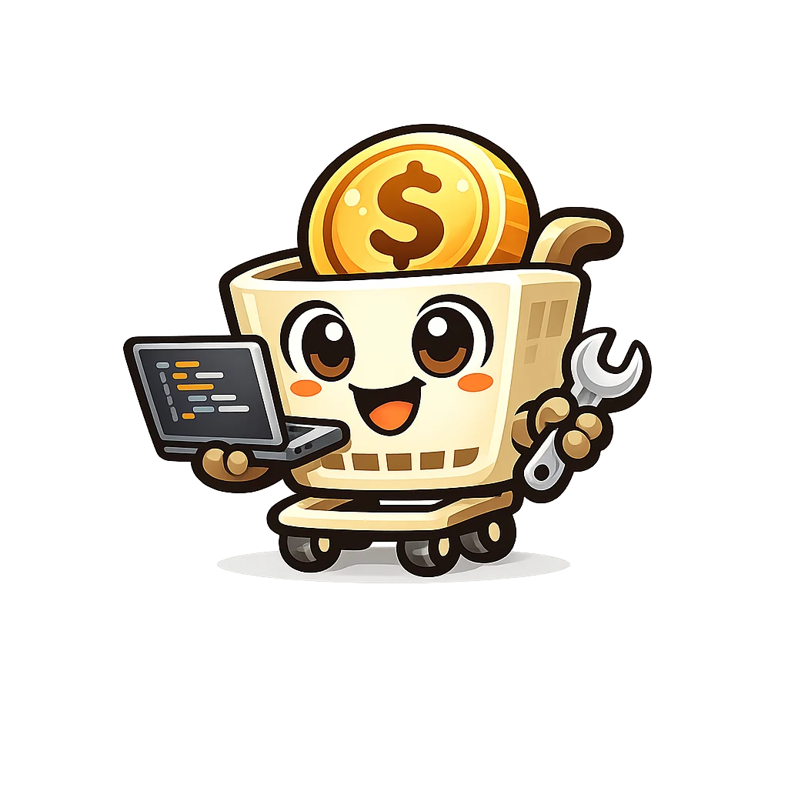

# Capacitor IAP

<div align="center">

[](https://npmjs.org/package/capacitor-iap) [](https://openiap.dev) [](https://github.com/hyodotdev/openiap/actions/workflows/ci-capacitor-iap.yml?query=branch%3Amain)

In-app purchases for Capacitor apps on iOS and Android, built on the OpenIAP Client Protocol. One TypeScript API covers StoreKit 2, Google Play Billing, Meta Horizon, and the Amazon Appstore.

<a href="https://openiap.dev"></a>

</div>

## Documentation

**[Setup guide →](https://openiap.dev/docs/setup/capacitor)**

The API matches expo-iap and react-native-iap without the React hooks, so the TypeScript examples in the [OpenIAP API reference](https://openiap.dev/docs/apis) apply as written.

## Installation

```bash
npm install capacitor-iap
npx cap sync
```

Requires Capacitor 8, iOS 15.0, and Android API 24.

- **iOS**: Swift Package Manager only, the Capacitor 8 default; a CocoaPods project migrates with `npx cap spm-migration-assistant`. Enable the In-App Purchase capability in Xcode.
- **Android**: the plugin links Google Play Billing by default. Pick another store with `openiapStore=horizon` or `openiapStore=amazon` in `android/gradle.properties`; see [Store selection](https://openiap.dev/docs/setup/store).

## Usage

```ts
import {
  confirmWithIapkit,
  createPurchaseFlow,
  fetchProducts,
  initConnection,
  requestPurchase,
} from 'capacitor-iap';

if (!(await initConnection())) throw new Error('Store connection failed');

// Confirms, finishes, and recovers every purchase the store delivers.
const purchaseFlow = createPurchaseFlow({
  isConsumable: (productId) => productId === 'coins_100',
  confirmWithBackend: confirmWithIapkit({apiKey: 'your-iapkit-key'}),
});
purchaseFlow.subscribe(({purchase, status}) => {
  console.log(purchase.productId, status.status);
});
await purchaseFlow.recoverPurchases();

const products = await fetchProducts({skus: ['coins_100'], type: 'in-app'});

await requestPurchase({
  request: {
    apple: {sku: 'coins_100'},
    google: {skus: ['coins_100']},
  },
  type: 'in-app',
});
```

Pass your own backend call as `confirmWithBackend` instead of IAPKit, or `confirmOnDeviceIOS()` for App Store apps without a backend.

Listeners such as `purchaseUpdatedListener` and `purchaseErrorListener` return a subscription with `remove()`. Purchases that arrive before the app listens, such as an unfinished transaction at launch, are held for the first `purchaseUpdatedListener`, and an App Store promotion for the first `promotedProductListenerIOS`; other events reach only current listeners. On the web every store call rejects with `feature-not-supported`.

## Example

[`example/`](./example) is a Vite app with the same screens and products as the other OpenIAP examples:

```bash
cd example
npm install
npm run ios      # or npm run android
```

## Contributing

See [AGENTS.md](./AGENTS.md) for the layout and checks, and the monorepo [Contributing Guide](../../CONTRIBUTING.md).

## Powered by OpenIAP

Capacitor IAP conforms to the **[OpenIAP Client Protocol](https://openiap.dev)** and runs on [openiap-apple](https://github.com/hyodotdev/openiap/tree/main/packages/apple) (StoreKit 2) and [openiap-google](https://github.com/hyodotdev/openiap/tree/main/packages/google) (Play Billing 9.1.0).

Other libraries built on OpenIAP: [react-native-iap](https://github.com/hyodotdev/openiap/tree/main/libraries/react-native-iap) · [expo-iap](https://github.com/hyodotdev/openiap/tree/main/libraries/expo-iap) · [flutter_inapp_purchase](https://github.com/hyodotdev/openiap/tree/main/libraries/flutter_inapp_purchase) · [kmp-iap](https://github.com/hyodotdev/openiap/tree/main/libraries/kmp-iap) · [godot-iap](https://github.com/hyodotdev/openiap/tree/main/libraries/godot-iap) · [maui-iap](https://github.com/hyodotdev/openiap/tree/main/libraries/maui-iap)

## Community

For bug reports, please [open an issue](https://github.com/hyodotdev/openiap/issues).

<!-- community:start -->
<!-- Generated by scripts/sync-sponsors.mjs from packages/docs/community-touchpoints.json. -->

## Built something with capacitor-iap?

List your app on the [OpenIAP showcase](https://openiap.dev/showcase).

Questions and feedback go to [Discussions](https://github.com/hyodotdev/openiap/discussions).

If capacitor-iap saves you time, a ⭐ on [hyodotdev/openiap](https://github.com/hyodotdev/openiap) helps.

<!-- community:end -->

<!-- sponsors:start -->
<!-- Generated by scripts/sync-sponsors.mjs from packages/docs/sponsor-registry.json. -->

## Sponsors

<p align="center">
  <a href="https://meta.com">
    
  </a>
  &nbsp;&nbsp;&nbsp;&nbsp;&nbsp;&nbsp;
  <a href="https://developer.amazon.com/">
    <picture>
      <source media="(prefers-color-scheme: dark)" srcset="https://openiap.dev/sponsors/amazon-dark.webp">
      
    </picture>
  </a>
</p>

Thank you to [Meta](https://meta.com) and [Amazon Developer](https://developer.amazon.com/) for supporting OpenIAP. [View sponsorship options](https://openiap.dev/sponsors).

### OpenCollective

We also recognize sponsors and backers through OpenCollective. The original react-native-iap collective now supports the broader OpenIAP ecosystem and is managed separately from the main sponsor program.

**Sponsors:** <a href="https://opencollective.com/openiap#sponsors"></a>

**Backers:** <a href="https://opencollective.com/openiap#backers"></a>

[Become a sponsor](https://opencollective.com/openiap#sponsor) | [Become a backer](https://opencollective.com/openiap#backer)

### Past supporters

Supported the project before the OpenIAP sponsor program.

<p align="center">
  <a href="https://namiml.com">
    
  </a>
  &nbsp;&nbsp;&nbsp;&nbsp;
  <a href="https://www.courier.com/?utm_source=react-native-iap&utm_campaign=osssponsors">
    
  </a>
</p>

[openiap-sponsors]: https://openiap.dev/sponsors
[openiap-github-sponsors]: https://github.com/sponsors/hyodotdev
[openiap-opencollective]: https://opencollective.com/openiap
[openiap-paypal]: https://www.paypal.me/dooboolab
[openiap-company-contact]: mailto:hyo@hyo.dev

<!-- sponsors:end -->
