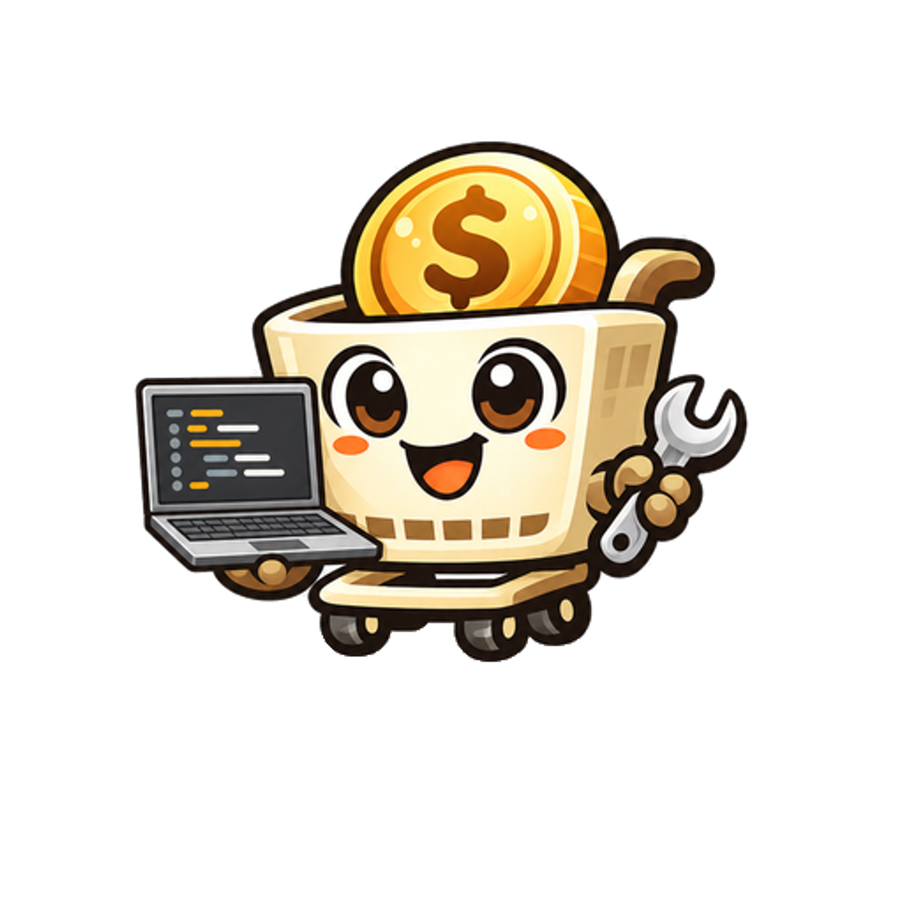

# OpenIAP Specification

<p align="center">
  
</p>

OpenIAP is a unified specification for in-app purchases across platforms, frameworks, and emerging technologies.

## Overview

The OpenIAP specification standardizes IAP implementations to reduce fragmentation and enable consistent behavior across all platforms. This is especially critical in the AI coding era where standardized APIs enable better code generation.

## Website

Visit [openiap.dev](https://openiap.dev) for full documentation.

## Preview deployments

Only `main` deploys automatically. Pull requests and other branches do not
start Vercel deployments. A maintainer or owner with deployment access to the
Hyo Dev Vercel team can create a preview from the reviewed checkout:

```sh
cd packages/docs
bun run deploy:preview
```

<!-- sponsors:start -->
<!-- Generated by scripts/sync-sponsors.mjs from packages/docs/sponsor-registry.json. -->

## Sponsors

<p align="center">
  <a href="https://meta.com"></a>
  &nbsp;&nbsp;&nbsp;&nbsp;&nbsp;&nbsp;
  <a href="https://developer.amazon.com/"><picture><source media="(prefers-color-scheme: dark)" srcset="https://openiap.dev/sponsors/amazon-dark.webp"></picture></a>
  &nbsp;&nbsp;&nbsp;&nbsp;&nbsp;&nbsp;
  <a href="https://codemagic.io/"><picture><source media="(prefers-color-scheme: dark)" srcset="https://openiap.dev/sponsors/codemagic-dark.svg"></picture></a>
</p>

Thank you to [Meta](https://meta.com), [Amazon Developer](https://developer.amazon.com/), and [Codemagic](https://codemagic.io/) for supporting OpenIAP. [View sponsorship options](https://openiap.dev/sponsors).

### In-kind support

<p align="center">
  <a href="https://claude.com/contact-sales/claude-for-oss"><picture><source media="(prefers-color-scheme: dark)" srcset="https://openiap.dev/sponsors/claude-dark.svg"></picture></a>
  &nbsp;&nbsp;&nbsp;&nbsp;
  <a href="https://codemagic.io/"><picture><source media="(prefers-color-scheme: dark)" srcset="https://openiap.dev/sponsors/codemagic-dark.svg"></picture></a>
</p>

[Claude for Open Source](https://claude.com/contact-sales/claude-for-oss) provides the Claude Ultra plan for the maintainer for 6 months.<br>[Codemagic](https://codemagic.io/) provides infrastructure support for OpenIAP.

### OpenCollective

We also recognize sponsors and backers through OpenCollective. The original react-native-iap collective now supports the broader OpenIAP ecosystem and is managed separately from the main sponsor program.

**Sponsors:** <a href="https://opencollective.com/openiap#sponsors"></a>

**Backers:** <a href="https://opencollective.com/openiap#backers"></a>

[Become a sponsor](https://opencollective.com/openiap#sponsor) | [Become a backer](https://opencollective.com/openiap#backer)

### Past supporters

Supported the project before the OpenIAP sponsor program: Nami for 30 months and Courier for 1 month.

<p align="center">
  <a href="https://namiml.com"></a>
  &nbsp;&nbsp;&nbsp;&nbsp;
  <a href="https://www.courier.com/?utm_source=react-native-iap&utm_campaign=osssponsors"></a>
</p>

[openiap-sponsors]: https://openiap.dev/sponsors
[openiap-github-sponsors]: https://github.com/sponsors/hyodotdev
[openiap-opencollective]: https://opencollective.com/openiap
[openiap-paypal]: https://www.paypal.me/dooboolab
[openiap-company-contact]: mailto:hyo@hyo.dev

<!-- sponsors:end -->
